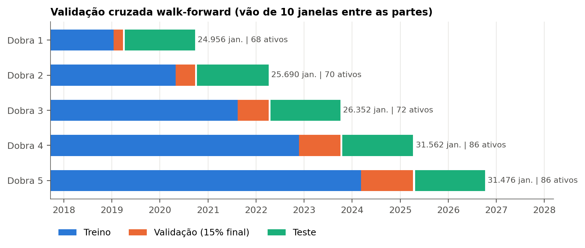

# B3 — coleta, tratamento e normalização dos dados

Etapa de dados de um comitê de redes LSTM para previsão de tendência de ações
da B3 em horizonte de swing trade (10 pregões). O projeto vai da coleta dos
preços até os tensores prontos para entrar na rede; não há treino nem
avaliação aqui.

## Resumo

- **Coleta:** OHLCV diário de 100 ativos da B3 via yfinance, 10 anos, preços
  sem ajuste por proventos (`auto_adjust=False`; o yfinance ainda corrige
  desdobramentos). Ativos com menos de 400 pregões são descartados.
- **Features:** 24 indicadores técnicos em 5 grupos, um por especialista do
  comitê — RSI (5), MACD (5), médias móveis (6), Bandas de Bollinger (4) e
  OBV/volume (4). Todos ficam em [-1, 1] por construção: diferenças
  normalizadas (a − b)/(a + b), eventos de cruzamento (±1) e indicadores
  binários. Não há z-score nem min-max, o que evita vazamento de estatísticas
  do futuro.
- **Rótulo:** método de horizonte fixo com limiar dinâmico (López de Prado,
  2018). O retorno de 10 pregões à frente é comparado a
  τ = 0,5 · σ₂₀ · √10, onde σ₂₀ é o desvio móvel de 20 retornos diários.
  Classes: −1 baixa, 0 neutra, +1 alta.
- **Entrada da rede:** janelas de 30 pregões, com forma
  `(amostras, 30, n_features)` por grupo.
- **Validação:** walk-forward com 5 dobras de calendário, iguais para todos os
  ativos. Os 15% finais do treino de cada dobra servem de validação (early
  stopping), com vão de 10 janelas entre treino, validação e teste para que o
  rótulo não enxergue o período seguinte.

## Resultados

Download de 23/10/2026 (24/10/2016 a 23/10/2026).

| Métrica | Valor |
|---|---|
| Ativos válidos | 86 |
| Candles | 196.460 |
| Janelas de 30 pregões | 175.992 |
| Baixa / neutra / alta | 29,0% / 38,9% / 32,1% |
| Limiar τ médio / mediano | 3,71% / 3,26% |

| Dobra | Treina até | Teste | Treino | Val. | Teste | Ativos |
|---|---|---|---|---|---|---|
| 1 | 26/03/2019 | 09/04/2019 – 25/09/2020 | 21.431 | 3.161 | 24.956 | 68 |
| 2 | 25/09/2020 | 09/10/2020 – 06/04/2022 | 43.845 | 7.067 | 25.690 | 70 |
| 3 | 06/04/2022 | 22/04/2022 – 04/10/2023 | 66.749 | 11.138 | 26.352 | 72 |
| 4 | 04/10/2023 | 19/10/2023 – 09/04/2025 | 94.567 | 15.893 | 31.562 | 86 |
| 5 | 09/04/2025 | 25/04/2025 – 08/10/2026 | 122.077 | 20.719 | 31.476 | 86 |

Dos 100 ativos, 8 não retornaram dados no yfinance (BRFS3, CCRO3, CIEL3,
CRFB3, GUAR3, JBSS3, PETZ3, STBP3) e 6 foram excluídos por falhas nos dados
(`config.EXCLUDED`, com o motivo de cada um): NATU3, PCAR3, UGPA3, SUZB3,
TEND3 e CPFE3.



## Arquivos

| Arquivo | Etapa |
|---|---|
| `config.py` | parâmetros: ativos, período, horizonte, janela, dobras e exclusões |
| `data_collection.py` | download OHLCV via yfinance, limpeza e filtro de histórico mínimo |
| `features.py` | indicadores transformados em índices de força em [-1, 1] |
| `dataset.py` | rótulo de 3 classes, alinhamento e janelas de 30 pregões |
| `walkforward.py` | divisão walk-forward por calendário com vão de 10 janelas |
| `process_data.py` | executa tudo e salva `outputs/resumo_dados.json` |
| `export_tensores.py` | tensores prontos para a LSTM, um `.npz` por dobra em `outputs/tensores/` |
| `visualizacoes.py` | figuras em `outputs/figuras/` |

## Uso

```
pip install -r requirements.txt
python process_data.py          # pipeline completo + resumo
python export_tensores.py       # tensores .npz por dobra
python visualizacoes.py         # figuras (opcional: python visualizacoes.py VALE3.SA)
```

A primeira execução baixa os dados e salva `outputs/prices_cache.pkl`; as
seguintes reutilizam o cache (apague o arquivo para baixar de novo). Como o
período é relativo à data do download, uma nova coleta pode gerar números
ligeiramente diferentes dos acima.

Cada `foldK.npz` contém `X_{GRUPO}_{train,val,test}` (`float32`,
`(N, 30, n_features)`), `y_{train,val,test}` (`int8`, −1/0/+1),
`ticker_*`, `data_*` e `features_{GRUPO}`. Para usar com
`CrossEntropyLoss` ou `sparse_categorical_crossentropy`, some 1 ao rótulo
(classes 0, 1, 2).

## Limitações

- O universo de ativos é a composição atual da bolsa (viés de sobrevivência).
- Os preços não são ajustados por dividendos e JCP, então as quedas nas
  datas-ex aparecem nos indicadores e no rótulo.
